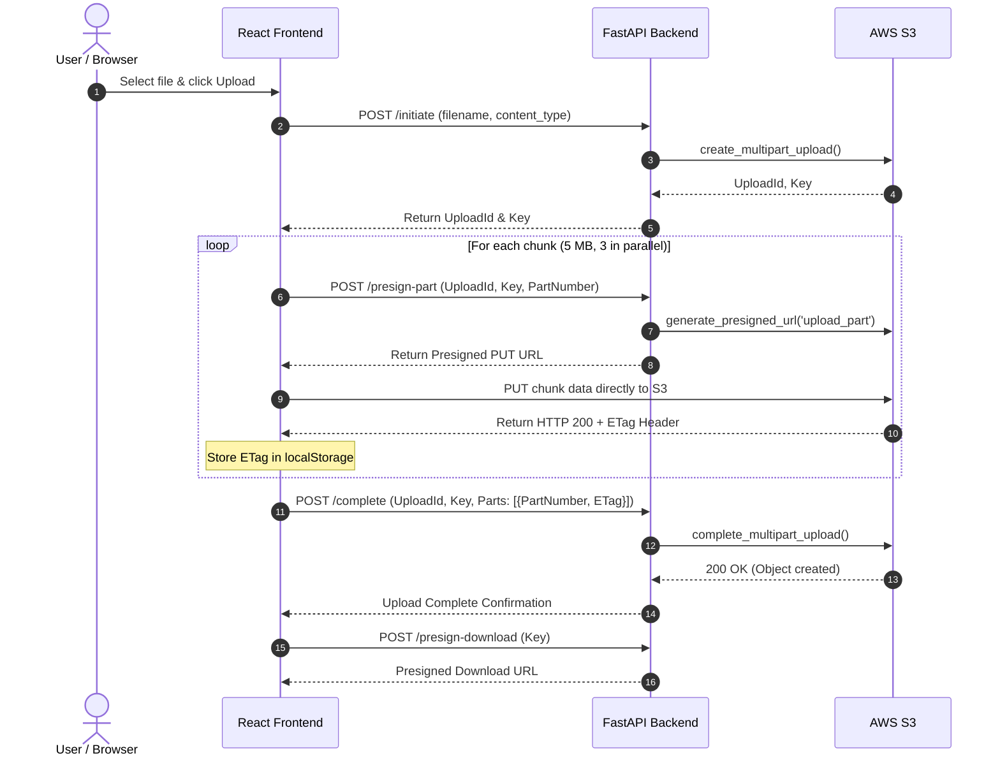

# S3 Multipart Upload Demo 🚀

A high-performance, full-stack application demonstrating **direct-to-S3 multipart file uploads** with chunking, concurrency, resumability, and presigned download URLs.

The client browser uploads parts directly to AWS S3 using presigned URLs generated by a FastAPI backend. This avoids proxying large files through the application server, saving bandwidth and preventing backend bottlenecks.

---

## ✨ Features

- **Direct-to-S3 Uploads**: Files never pass through the backend server; parts are streamed directly from the browser to Amazon S3 using presigned URLs.
- **Multipart Chunking**: Automatically splits large files into 5 MB chunks according to AWS S3 specifications.
- **Concurrent Uploads**: Uploads multiple parts simultaneously (`CONCURRENCY = 3`) for faster transfers.
- **Resumable Uploads**: Upload state and part ETags are persisted in `localStorage`. If an upload is paused or interrupted, it can resume from the last completed part.
- **Upload Cancellation**: Abort active in-flight transfers using `AbortController` and clean up pending multipart uploads on S3.
- **Secure File Downloads**: Generates temporary, time-limited presigned GET URLs (valid for 1 hour).
- **File Explorer**: Lists all files stored in the S3 bucket's `uploads/` prefix with file sizes and upload timestamps.

---

## 🏗️ Architecture & Workflow



---

## 🛠️ Tech Stack

- **Backend**: [FastAPI](https://fastapi.tiangolo.com/), [Uvicorn](https://www.uvicorn.org/), [Boto3 (AWS SDK for Python)](https://boto3.amazonaws.com/v1/documentation/api/latest/index.html), [Pydantic](https://docs.pydantic.dev/)
- **Frontend**: [React 19](https://react.dev/), [Vite](https://vite.dev/), [Axios](https://axios-http.com/)
- **Storage**: [Amazon Web Services (AWS) S3](https://aws.amazon.com/s3/)

---

## 📁 Project Structure

```text
s3-demo/
├── backend/
│   ├── main.py              # FastAPI application with S3 endpoints
│   ├── requirements.txt     # Python backend dependencies
│   ├── .env.example         # Template for AWS environment variables
│   └── venv/                # Python virtual environment (ignored in git)
├── frontend/
│   ├── src/
│   │   ├── App.jsx          # Upload UI, chunking, concurrency & resume logic
│   │   ├── App.css          # Component styles
│   │   ├── index.css        # Global CSS styles
│   │   └── main.jsx         # Application entry point
│   ├── package.json         # Frontend dependencies and scripts
│   └── vite.config.js       # Vite configuration
├── .gitignore               # Ignored files (venv, node_modules, .env, etc.)
└── README.md                # Project documentation
```

---

## ⚙️ Prerequisites

1. **Python 3.10+**
2. **Node.js 18+** & npm
3. **AWS Account** with an active S3 bucket and IAM credentials (`s3:PutObject`, `s3:GetObject`, `s3:ListBucket`, `s3:AbortMultipartUpload`).

---

## ☁️ AWS S3 Bucket Setup & CORS

Because parts are uploaded directly from your browser to S3 via presigned URLs, you **must** configure **Cross-Origin Resource Sharing (CORS)** on your S3 bucket.

1. Go to the **AWS S3 Console** -> Select your bucket -> **Permissions** tab.
2. Scroll to **Cross-origin resource sharing (CORS)** and paste:

```json
[
    {
        "AllowedHeaders": [
            "*"
        ],
        "AllowedMethods": [
            "GET",
            "PUT",
            "POST",
            "HEAD"
        ],
        "AllowedOrigins": [
            "http://localhost:5173",
            "http://127.0.0.1:5173"
        ],
        "ExposeHeaders": [
            "ETag"
        ],
        "MaxAgeSeconds": 3000
    }
]
```

> [!IMPORTANT]
> The `"ExposeHeaders": ["ETag"]` rule is mandatory. AWS S3 returns the part checksum in the `ETag` header, which the frontend must read to complete the multipart upload.

---

## 🚀 Getting Started

### 1. Clone the Repository
```bash
git clone git@personal:Suprabha47/S3_Demo.git
cd S3_Demo
```

### 2. Backend Setup
1. Navigate to the `backend` folder:
   ```bash
   cd backend
   ```
2. Create and activate a virtual environment:
   ```bash
   # Windows (PowerShell)
   python -m venv venv
   .\venv\Scripts\Activate.ps1

   # Linux / macOS
   python3 -m venv venv
   source venv/bin/activate
   ```
3. Install dependencies:
   ```bash
   pip install -r requirements.txt
   ```
4. Create a `.env` file from `.env.example`:
   ```bash
   cp .env.example .env
   ```
5. Fill in your AWS credentials in `backend/.env`:
   ```env
   AWS_ACCESS_KEY_ID=your_access_key_here
   AWS_SECRET_ACCESS_KEY=your_secret_key_here
   AWS_REGION=ap-south-1
   S3_BUCKET=your-bucket-name
   ```
6. Start the FastAPI backend server:
   ```bash
   uvicorn main:app --reload --port 8000
   ```
   Backend will be available at `http://127.0.0.1:8000` (API docs at `http://127.0.0.1:8000/docs`).

### 3. Frontend Setup
1. Open a new terminal and navigate to `frontend`:
   ```bash
   cd frontend
   ```
2. Install dependencies:
   ```bash
   npm install
   ```
3. Start the Vite development server:
   ```bash
   npm run dev
   ```
4. Open the browser at `http://localhost:5173`.

---

## 📡 API Reference

| Method | Endpoint | Description | Request Body |
| :--- | :--- | :--- | :--- |
| `GET` | `/` | Health check endpoint | None |
| `POST` | `/initiate` | Initiates S3 multipart upload and returns `upload_id` and `key` | `{ "filename": "...", "content_type": "..." }` |
| `POST` | `/presign-part` | Generates presigned URL for a single part | `{ "upload_id": "...", "key": "...", "part_number": 1 }` |
| `POST` | `/complete` | Finalizes the multipart upload in S3 | `{ "upload_id": "...", "key": "...", "parts": [...] }` |
| `POST` | `/abort` | Cancels in-progress multipart upload on S3 | Query params: `upload_id`, `key` |
| `GET` | `/files` | Lists files in the `uploads/` prefix | None |
| `POST` | `/presign-download` | Generates a 1-hour presigned download link | `{ "key": "uploads/..." }` |

---

## 🛡️ Security Notes

- **Never commit `.env` files**: All secret keys and credentials are kept in `.env`, which is excluded by `.gitignore`.
- **Pre-signed URLs**: All operations run with temporary pre-signed credentials; credentials are never exposed to the frontend.
- **Scoped IAM Permissions**: Use an IAM role or user with least-privilege permissions restricted only to your target bucket.
